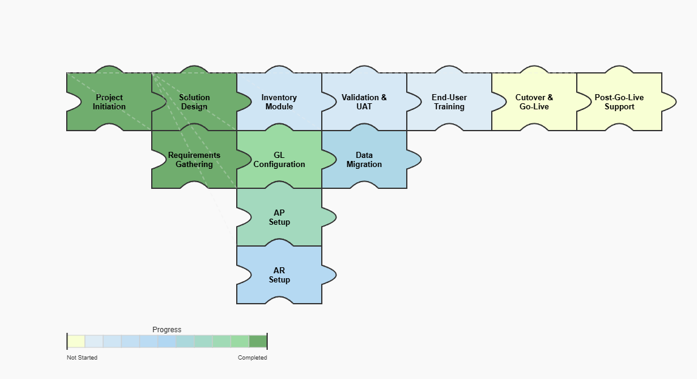

# Vega Garden 🌱

A growing collection of advanced data visualization examples built with [Vega](https://vega.github.io/vega/), [Vega-Lite](https://vega.github.io/vega-lite/), [Deneb](https://deneb-viz.github.io/) and [Power BI](https://powerbi.microsoft.com/).

Each example ships with:

- 📄 **A standalone Vega spec** you can paste straight into the [Vega Editor](https://vega.github.io/editor/) — no Power BI required.
- 💾 **A sample dataset** so the chart renders out of the box.
- 📊 **A Power BI PBIP project** with the visual wired up in Deneb, ready to open in Power BI Desktop.
- 📝 **A README** explaining how the chart works and how to customize it.

> [!NOTE]
> This repository is inspired by the excellent [Deneb-Showcase](https://github.com/PBI-David/Deneb-Showcase) by Davide Bacci — go check it out for many more advanced examples.

## 🤖 AI Assistance Disclosure

Transparency matters. Please note that:

- **The README files in this repository were prepared with the assistance of a large language model (LLM)**, based on the author's chart specifications and project files.
- **The sample datasets included here are synthetic and were generated with the assistance of an LLM.** They depict a fictional ERP implementation project and contain no real data.
- The **initial draft of the SVG path for the puzzle piece** was produced with the assistance of an LLM and then tweaked manually by the author.
- All Vega/Vega-Lite specifications, Power BI projects and Deneb configurations were authored by [Christian Bermudez](https://www.linkedin.com/in/cjber/).

## 🗂️ The Garden

| # | Visualization | Description | Tools | Folder |
|---|---------------|-------------|-------|--------|
| 1 | **Puzzle Flow** | An ERP implementation project flow rendered as interlocking puzzle pieces, with progress encoded as color | Vega · Deneb · Power BI | [`Puzzle_Flow/`](Puzzle_Flow/) |

<!-- To add a new entry: duplicate the row above, add a thumbnail image to the chart folder, and create a README.md inside it. -->

### 🧩 Puzzle Flow



A hierarchical project plan — phases, modules, tasks and deliverables — drawn as a grid of interlocking puzzle pieces. Each piece is colored by its completion percentage, connected to its parent with dashed links, and fully tooltipped.

- [Explore the spec](Puzzle_Flow/Vega_Spec/puzzle_flow_spec.json) — try it in the [Vega Editor](https://vega.github.io/editor/)
- [Open in Power BI](Puzzle_Flow/PowerBI/) — Deneb visual pre-configured
- [Read how it works](Puzzle_Flow/README.md)

## 📁 Repository Structure

Each chart lives in its own folder with a `README.md`, a `Vega_Spec/` (spec + sample data) and a `PowerBI/` project:

```
Puzzle_Flow/   # Chart #1
```

## 💡 Share Your Ideas!

This garden is just getting started, and **I'd love to hear what you'd like to see next**. Whether it's a sketch on a napkin, a chart you saw in the wild, or a business problem that no stock visual seems to solve — ideas for new Vega/Deneb visualizations are very welcome.

Some directions I'm curious about (but don't let these limit you):

- Alternative layouts for the puzzle flow (timeline, swimlane, nested grouping)
- Other "shape-based" metaphors for project/process data (gears, bricks, honeycombs…)
- Interactive drilldowns and cross-filtering in Deneb
- Progress/status visuals for executive dashboards

### How to share

- 💬 **Open an issue** in this repository describing your idea (a rough sketch or sample data helps a lot!).
- 🔗 **Reach out on [LinkedIn](https://www.linkedin.com/in/cjber/)** — I'm always happy to talk dataviz.

If you build something with these specs, fork away — and if you'd like your variation featured here, open an issue or a pull request.

## 🙏 Credits & Links

- [Vega](https://vega.github.io/vega/) & [Vega-Lite](https://vega.github.io/vega-lite/) — declarative visualization grammars
- [Deneb](https://deneb-viz.github.io/) — the custom visual that brings Vega to Power BI
- [Power BI](https://powerbi.microsoft.com/)
- [Deneb-Showcase by Davide Bacci](https://github.com/PBI-David/Deneb-Showcase) — the inspiration for this repository's format

---

## 👤 About

**Christian Bermudez** — Data & Analytics

- LinkedIn: [https://www.linkedin.com/in/cjber/](https://www.linkedin.com/in/cjber/)
- GitHub: [https://github.com/cjber22](https://github.com/cjber22)
